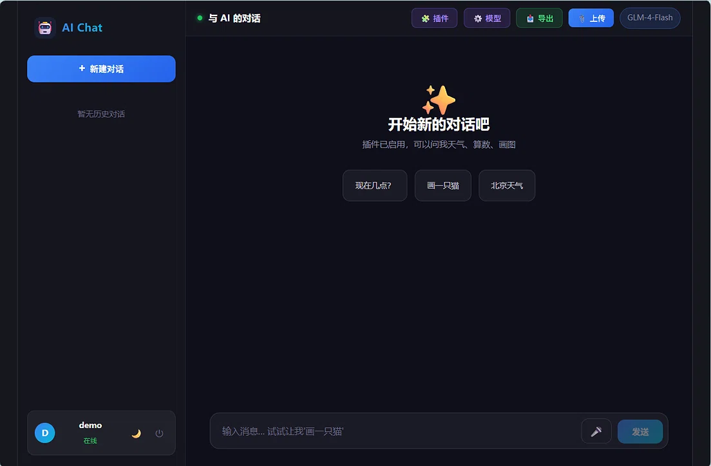
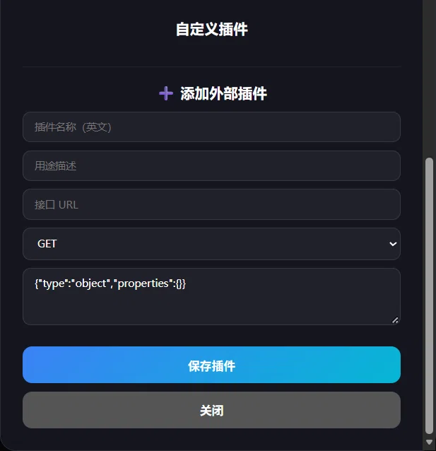
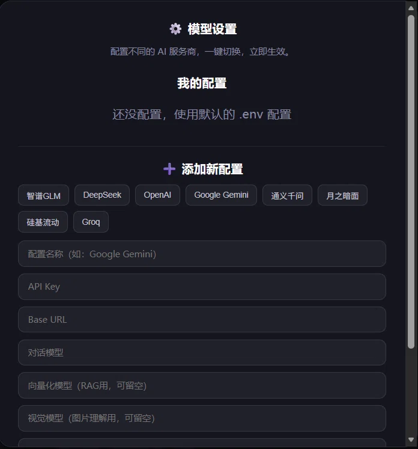

# 🤖 Full-stack AI App

一个基于 FastAPI + Vue3 + MySQL 的全栈 AI 聊天机器人，支持 RAG 文档问答、Agent 工具调用、多用户登录、多模型一键切换。

## ✨ 功能特性

- 🔐 **JWT 多用户登录**：数据完全隔离，每个用户有自己独立的会话和文档
- 💬 **多会话管理**：支持新建、重命名、删除、历史记忆
- 🧠 **MySQL 长期记忆**：关掉终端重开，AI 依然记得你
- 📚 **RAG 文档问答**：支持 PDF / Word / TXT / 图片，上传后自动切片向量化
- 🛠 **Agent 工具调用**：支持查时间、查天气、数学计算、AI 画图
- 🎨 **AI 图片生成**：接入 CogView-3-Flash，完全免费
- 🌐 **多模型一键切换**：内置智谱 / DeepSeek / OpenAI / Google Gemini / 通义千问等模板，改配置不用改代码
- 🎤 **语音输入**：基于浏览器 Web Speech API
- ⌨️ **SSE 流式输出**：逐字打印，打字机效果
- 🌗 **深浅色主题**：一键切换

## 🛠 技术栈

| 层级 | 技术 |
|------|------|
| 后端 | Python 3.11 / FastAPI / PyMySQL / JWT |
| 前端 | Vue 3 / Vite / Markdown-it / Highlight.js |
| AI | GLM-4-Flash / CogView-3 / Embedding-3 |
| 向量库 | ChromaDB |
| 数据库 | MySQL 8.0 |
| 工具链 | Git / VS Code / PyCharm / DataGrip |

## 🚀 快速开始

### 1. 克隆项目

\`\`\`bash
git clone https://github.com/sanxiu-weiwei/Full-stack-AI-app.git
cd Full-stack-AI-app
\`\`\`

### 2. 启动后端

\`\`\`bash
cd my_ai_project
python -m venv .venv

# Windows:
.venv\Scripts\activate
# macOS / Linux:
# source .venv/bin/activate

pip install -r requirements.txt
cp .env.example .env    # 然后填入你的 API Key 和数据库密码
uvicorn api:app --reload --port 8000
\`\`\`

### 3. 启动前端

\`\`\`bash
cd ai-chat-frontend
npm install
npm run dev
\`\`\`

打开浏览器访问 `http://localhost:5173`。

## 📸 运行截图

### 聊天界面

### 插件配置

### 模型切换

## 📝 数据库初始化

在 MySQL 中执行 `my_ai_project/schema.sql`（或手动执行建表语句）。

## 👨💻 作者

**三迷修**

- GitHub: [@sanxiu-weiwei](https://github.com/sanxiu-weiwei)
- 项目地址: [Full-stack-AI-app](https://github.com/sanxiu-weiwei/Full-stack-AI-app)

如果这个项目对你有帮助，欢迎点个 ⭐ Star！

## 📄 License

MIT